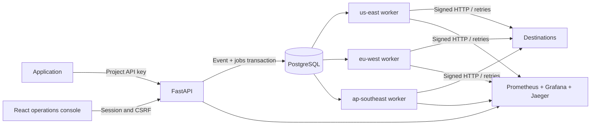
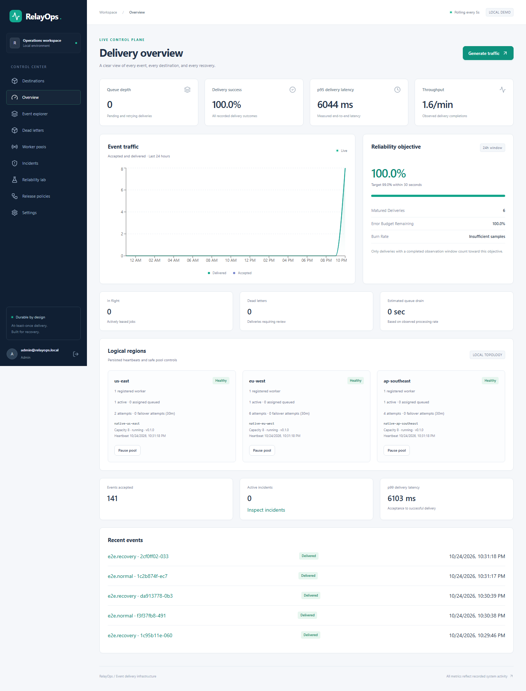
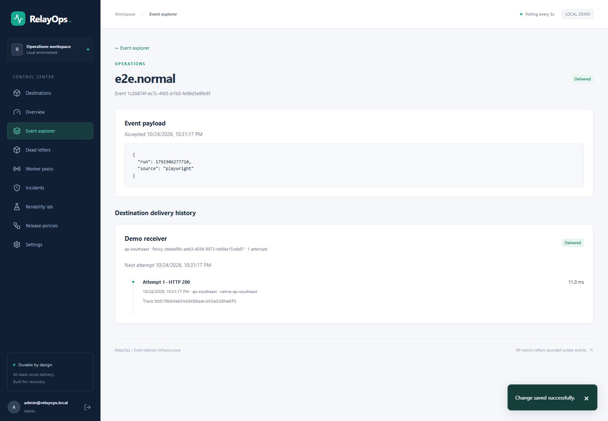

# RelayOps

RelayOps is a durable event-delivery service and operations console. Applications
submit an event once; PostgreSQL stores its destination jobs atomically, and
bounded asynchronous workers deliver signed webhooks with retries, recovery and
an inspectable attempt history.

The local reliability lab changes a real receiver's behavior so operators can
investigate failures, observe retries, manage incidents and recover delivery.
All operational values come from API/database activity; empty datasets remain
empty.

## Local quick start

Requirements: Python 3.12+, Docker Engine with Compose v2, and optionally Make.

```sh
make demo
# Cross-platform equivalent, including Windows:
python scripts/demo.py demo
```

The launcher generates ignored local secrets if missing, builds the services,
waits for health checks, applies migrations through one initialization service,
and bootstraps an administrator and demo project/destination. Read `ADMIN_EMAIL`
and `ADMIN_PASSWORD` from the generated `.env` locally to sign in. Do not paste
that file into logs or commit it. Grafana uses username `admin` and the generated
`GRAFANA_PASSWORD`.

| Service | Local URL |
| --- | --- |
| Operations console | <http://localhost:8080> |
| API documentation | <http://localhost:8000/docs> |
| API readiness | <http://localhost:8000/ready> |
| Grafana | <http://localhost:3000> |
| Prometheus | <http://localhost:9090> |
| Jaeger | <http://localhost:16686> |

```sh
make down     # Stop services; preserve data volumes
make up       # Start again
make smoke    # Verify actual ingestion, delivery and retry recovery
```

`make clean` deletes demo volumes and their data. It is not an ordinary shutdown
or recovery command. No cloud account or external API key is required.

Without Docker, an existing PostgreSQL server can run the application through
`scripts/native.py --frontend`; see [native development](docs/NATIVE.md).
That path starts the API, receiver, three workers and Vite, but not monitoring.

## Architecture and capabilities



- Atomic ingestion with project-scoped idempotency and queue admission limits.
- PostgreSQL row claims, leases, fencing, bounded concurrency and persisted retry
  schedules; dead-letter inspection and authorized redrive.
- Authenticated operations, role checks, CSRF protection, hashed ingestion keys,
  encrypted webhook secrets and audit records.
- Logical worker pools with heartbeat monitoring, pause/resume and failover.
- Real delivery measurements, matured-window SLO calculations and incidents.
- A signature-verifying local receiver with outage, latency and rate-limit modes.
- Versioned delivery policies with deterministic canary assignment, promotion
  and rollback for future assignments.

Stack: Python/FastAPI/Pydantic, SQLAlchemy async/PostgreSQL/Alembic, httpx,
OpenTelemetry and Prometheus; React/TypeScript/Vite, TanStack Query, Tailwind and
Recharts. Docker Compose packages the local system without a message broker.

Delivery is **at least once**. A receiver must atomically deduplicate event IDs
with its business operation. The three worker regions are independent local
processes, not geographically redundant infrastructure.

## API example

Create a project-scoped key in Settings. Keep it in your shell environment rather
than a committed script. Substitute the project's ID below.

```sh
curl --fail-with-body http://localhost:8000/api/events \
  -H "Authorization: Bearer $RELAYOPS_API_KEY" \
  -H 'Content-Type: application/json' \
  -H 'Idempotency-Key: example-order-001' \
  -d '{"project_id":"PROJECT_ID","type":"order.created","payload":{"order_id":"example-001"}}'
```

Reusing the same project/key and content returns the existing event. Reusing it
with conflicting content returns a conflict. Acceptance is acknowledged only
after the event and all matching jobs commit. See [API contract](API_CONTRACT.md)
and the running OpenAPI documentation for the control-plane endpoints.

## Reliability walkthrough

1. Sign in and confirm worker heartbeats on Worker Pools.
2. Open Reliability Lab and generate a small real event batch.
3. Inspect an event's destinations and persisted attempts in Event Explorer.
4. Activate intermittent failure or a destination outage and generate more work.
5. Observe HTTP failure attempts, retries and queue depth; incident detection
   requires its configured thresholds, so a tiny batch may not open an incident.
6. Restore Normal mode and resume any paused pools. Inspect queue drainage.
7. Inspect Grafana's actual counters/histograms and correlate an attempt in Jaeger.
8. Create a candidate delivery policy, assign a canary percentage, generate new
   work, compare measured outcomes and promote or roll back.

Faults are limited to the configured demo receiver. Configuration releases
change delivery policies; they do not deploy new application binaries.

## Testing and performance

```sh
make test
make lint
make smoke
make benchmark
```

PostgreSQL integration tests require a dedicated test database. They exercise
locking and transactions against PostgreSQL rather than substituting SQLite.
Frontend unit tests use Vitest and browser tests use Playwright against the real
application. See [performance methodology](docs/PERFORMANCE.md) for benchmark
commands and measured evidence, and [implementation ledger](docs/IMPLEMENTATION.md)
for checks actually executed in the build environment.

GitHub Actions definitions are supplied for future CI and tagged container
releases. Their presence is not a claim that hosted CI or publishing has run.

## Documentation

- [Architecture](docs/ARCHITECTURE.md) and [design tradeoffs](docs/TRADEOFFS.md)
- [Operations runbook](docs/RUNBOOK.md) and [SLO definitions](docs/SLO.md)
- [Security controls and deployment obligations](SECURITY.md)
- [Performance](docs/PERFORMANCE.md), [release process](docs/RELEASE.md), and
  [observed fault exercise](docs/INCIDENT_REPORT.md)

## Repository

```text
backend/          API, models, migrations, workers and tests
frontend/         Operations console and browser tests
demo-sink/        Local signature-verifying fault receiver
infrastructure/   Monitoring provisioning
scripts/          Bootstrap and smoke tooling
benchmarks/       Load generation and measurement
docs/             Architecture, operations and evidence
.github/workflows CI and future tagged releases
```

## Screenshots and limitations

These screenshots show the running native application and persisted delivery data.




The [mobile event explorer](docs/screenshots/mobile-events.png) was also checked
in Chromium. See the [verification ledger](docs/IMPLEMENTATION.md) and
[requirements audit](docs/REQUIREMENTS.md) for executed checks and limitations.

This is a single-database local deployment. It does not provide geographic
redundancy, automatic database disaster recovery or an independently audited
production security posture. Production requires TLS, trusted approved
destinations and network egress controls, private observability services, backup
and retention policies, and secret management. Read [SECURITY](SECURITY.md)
before changing the localhost exposure boundary.

Licensed under [MIT](LICENSE).
