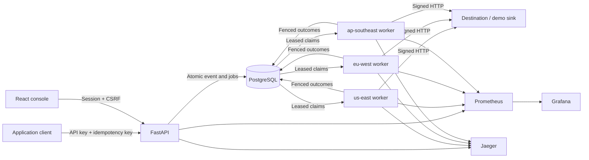
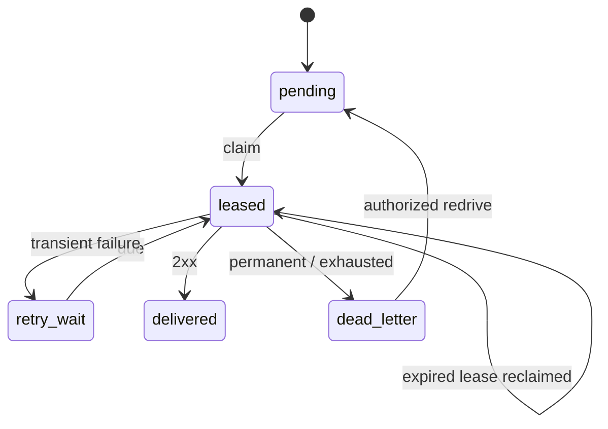

# Architecture

RelayOps is a modular application with a React control plane, a FastAPI API,
independent asyncio worker processes and one PostgreSQL database. The demo sink
is a controlled HTTP receiver. Prometheus, Grafana and Jaeger observe the system;
they do not participate in its delivery durability boundary.

## Data boundaries

- Users, sessions and project-scoped API keys authenticate access.
- Projects own destination subscriptions and events.
- Each event has a project-scoped unique idempotency key and a payload digest.
- A delivery joins an event, destination and immutable selected policy version.
- Attempts record worker, region, timings, HTTP outcome and trace reference.
- Pools and workers record pause controls and persisted heartbeat state.
- Policies and singleton control state select stable/candidate versions.
- Incidents retain evidence and timelines; audit records describe administrative
  actions without storing credentials.

## Ingestion transaction

Authenticate first, validate the JSON envelope and size, then evaluate the
project's enabled subscriptions. Compare the canonical request digest for a
reused idempotency key. The database uniqueness constraint is the ultimate
duplicate guard. A matching retry returns the existing event; conflicting input
returns a conflict.

Admission control and event/job insertion execute within the durable transaction.
Only after commit may the API acknowledge acceptance. Capacity rejection leaves
no partially accepted event or delivery set. The pending bound counts durable
outstanding work rather than an unbounded process-local queue.

## Worker transaction boundaries

Claim due work in a short transaction with row locking and `SKIP LOCKED`.
Persist lease owner, expiration and a new lease version, then commit. The worker
performs HTTP outside that transaction with bounded concurrency and timeouts.
Completion checks the lease owner/version before updating delivery state.
An expired lease can be reclaimed; a stale completion cannot overwrite the new
owner's state.

The durable lifecycle is:

Network errors, timeouts, HTTP 408, 429 and 5xx are retryable. Ordinary permanent
4xx responses terminate the delivery. Backoff and jitter are bounded; retry
schedules survive restarts. An event's aggregate status reflects all destination
outcomes, while individual deliveries remain visible.

## Security boundaries

The console uses authenticated cookie sessions and CSRF headers for mutations.
Roles separate administration, operations and read-only use. API keys are scoped
to one project and stored as digests. Signing secrets require reversible
encryption because workers need them for HMAC calculation; the encryption key
belongs outside the database.

Production destinations use HTTPS and an explicit approved-host policy. Demo
HTTP access is limited to the configured receiver origin and webhook path.
The reliability lab cannot select arbitrary targets. See [SECURITY](../SECURITY.md)
for deployment obligations and the boundary of host allowlisting.

## Observability

Counters and duration histograms measure actual processing. Each worker exposes
its own metrics endpoint so independent process registries are scraped.
Database-derived aggregates support the console's backlog and historical views.
Do not add event or delivery IDs as Prometheus labels.

Trace context accompanies persisted events so later worker spans can connect to
ingestion. Safe identifiers belong in trace attributes; payloads, cookies,
authorization headers and signing credentials do not. Attempt records provide a
durable correlation path when an external trace backend is unavailable.

## Failure scope

Workers can fail independently, recover leases and reassign stalled logical
regions. They share one database and local host. Database loss is outside this
process-failover demonstration. Delivery remains at least once, and receivers
must handle duplicate requests. See [TRADEOFFS](TRADEOFFS.md) for scaling and
geographic limitations.
